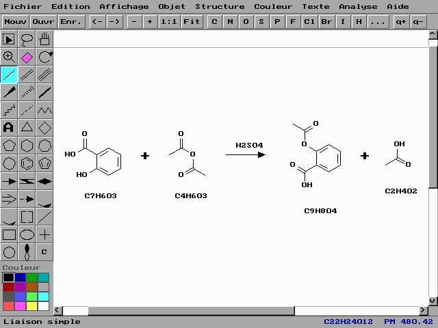

# QChimie
Liste de commandes écrite en Pascal (Turbo Pascal ou Free Pascal) sur la chimie.

Aperçu de la commande PyMOL :

Aperçu de la commande ChemDraw :

<h2>Liste des fichiers</h3>

Voici la liste des différents fichiers proposés dans QChimie :

<table>
  <tr>
    <th>Nom</th>
    <th>Description</th>
  </tr>
  <tr>
      <td><b>ELEMENTS.PAS</b></td>
      <td>Cette commande permet d'afficher le tableau des éléments chimiques ou un élément chimique.</td>
  </tr>
  <tr>
      <td><b>FORMULA.PAS</b></td>
      <td>Cette commande permet d'afficher la formule d'un élément chimique ou d'un composé chimique.</td>
  </tr>	
  <tr>
      <td><b>FINDELEM.PAS</b></td>
      <td>Cette commande permet de détecter les éléments chimiques mentionné dans un texte.</td>
  </tr>
  <tr>
	  <td><b>PYMOL.PAS</b></td>
	  <td>Cette commande permet de visualiser, manipuler et analyser des structures moléculaires tridimensionnelles, not amment des protéines, des acides nucléiques et des composés chimiques, à l'aide du logiciel PyMOL.</td>
  </tr>
  <tr>
	  <td><b>CHEMDRAW.PAS</b></td>
	  <td>Cette commande permet de dessiner des structures chimiques en deux dimensions (molécules, réactions, flèches, cycles, groupes d'atomes), de les analyser (formule, poids moléculaire, masse exacte, spectre de masse, prédiction RMN ¹H et ¹³C, nom du composé, SMILES, InChI, stéréochimie R/S et E/Z) et de les importer ou exporter aux formats CDT, MOL, SMILES, InChI, SVG et BMP, à la manière du logiciel ChemDraw.</td>
  </tr>
</table>

<h2>Compilation</h2>
	
Les fichiers Pascal n'ont aucune dépendances, il suffit de télécharger le fichier désiré et de le compiler avec Free Pascal avec la syntaxe de commande  :

<pre><b>fpc</b> <i>LEFICHIER.PAS</i></pre>
	
Sinon, vous pouvez également le compiler avec le Turbo Pascal à l'aide de la syntaxe de commande suivante :	

<pre><b>tpc</b> <i>LEFICHIER.PAS</i></pre>
	
Par exemple, si vous voulez compiler ELEMENTS.PAS, vous devrez tapez la commande suivante :

<pre><b>fpc</b> ELEMENTS.PAS</pre>

<h2>Remarque</h2>

<ul>
	<li>La commande CHEMDRAW accepte en ligne de commande un fichier à ouvrir (CDT, MOL, SDF ou SMI) ou une structure SMILES avec le paramètre -s (par exemple : <i>CHEMDRAW -s CC(=O)Oc1ccccc1C(O)=O</i>). Des exemples sont fournis dans le dossier SAMPLES/CHEMDRAW. Le format CDT est le format texte natif de la commande.</li>
	<li>L'InChI produit par la commande CHEMDRAW (menu Analyse) couvre la formule, la connectivité, les hydrogènes (y compris mobiles), la charge et la stéréochimie (couches /b, /t, /m et /s, calculées à partir des coins pleins, des hachures et de la géométrie des doubles liaisons) d'une molécule connexe, sans isotopes. Sur un échantillon de 4 900 molécules sans stéréochimie, il est identique à celui de la bibliothèque InChI officielle dans 98,8 % des cas ; sur 3 000 stéréoisomères la couche stéréochimique est identique dans tous les cas où la structure est correctement lue, hormis les doubles liaisons de grands cycles et quelques cations conjugués. Les fragments multiples et les organométalliques ne sont pas pris en charge.</li>
	<li>La stéréochimie de la commande CHEMDRAW (menu Affichage &gt; Stéréochimie, ou menu Analyse &gt; Stéréochimie) attribue les descripteurs CIP R/S aux centres dessinés avec un coin plein ou hachuré (extrémité fine sur le centre) et les descripteurs E/Z aux doubles liaisons substituées. Les priorités sont calculées avec un digraphe hiérarchique (atomes dupliqués, hydrogènes implicites, doublets libres) selon les règles 1 à 5 (numéro atomique, nombre de masse, Z avant E, unités chirales avant pseudo-asymétriques, like avant unlike, r avant s, R avant S) : les centres pseudo-asymétriques (r/s), les alditols symétriques et les cycles symétriques 1,3- ou 1,4-disubstitués sont donc étiquetés. Les symboles @ / @@ et / \ du SMILES sont lus (ils deviennent des coins pleins ou hachurés) et écrits, y compris pour les doubles liaisons des grands cycles (jusqu'à 40 atomes, dessinés avec des coudes pour les liaisons trans) ; la stéréochimie est conservée par la commande Nettoyer. Sur 3 001 stéréoisomères tirés d'une collection de molécules, 2 982 (99,4 %) reçoivent exactement les mêmes descripteurs que la bibliothèque RDKit ; les écarts restants concernent des systèmes pontés ou fusionnés (bicycles, azote en tête de pont), des complexes métalliques et quelques cycles symétriques couplés. L'InChI exporté contient la couche stéréochimique (/b, /t, /m, /s).</li>
	<li>La commande FORMULA a été bonifié du paramètre /FORMAT:HTML à partir de sa version 1.1.</li>
</ul>

<h2>Licence</h2>
<ul>
 <li>Le code source est publié sous la licence <a href="https://github.com/gladir/QCHIMIE/blob/main/LICENSE">MIT</a>.</li>
 <li>Le paquet original est publié sous la licence <a href="https://github.com/gladir/QCHIMIE/blob/main/LICENSE">MIT</a>.</li>
</ul>
